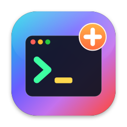
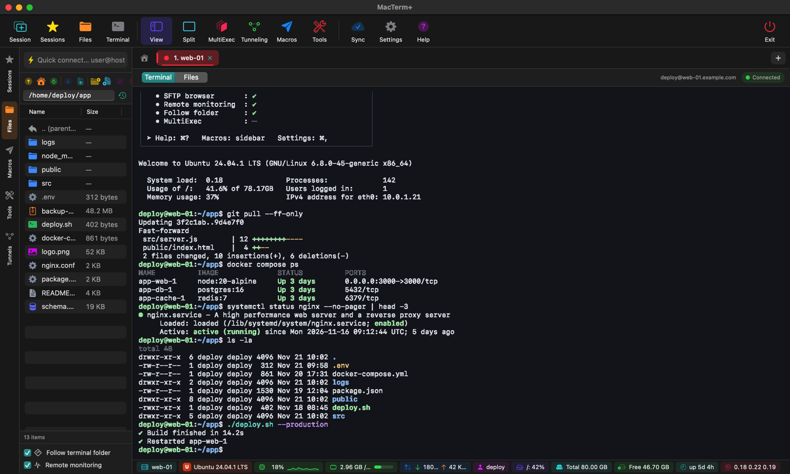
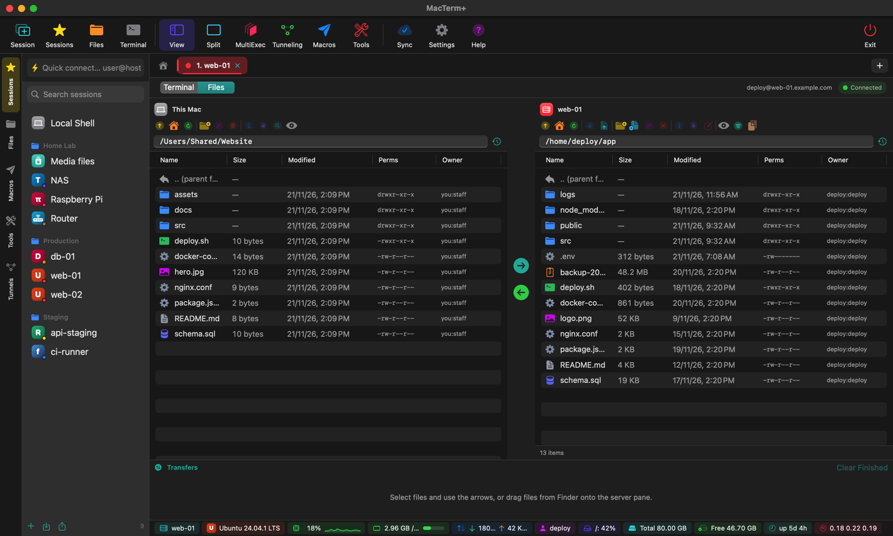
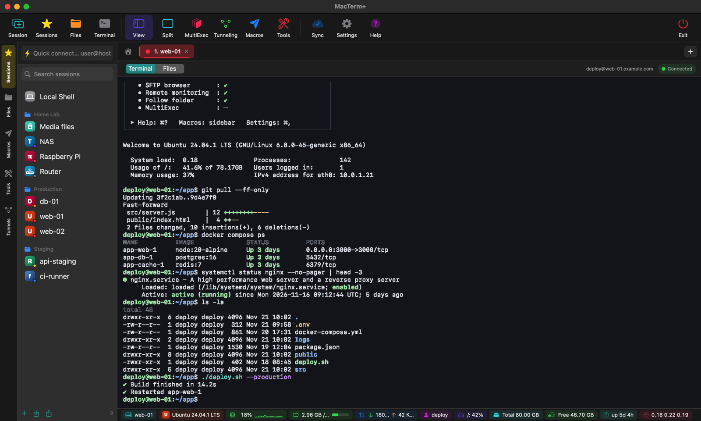
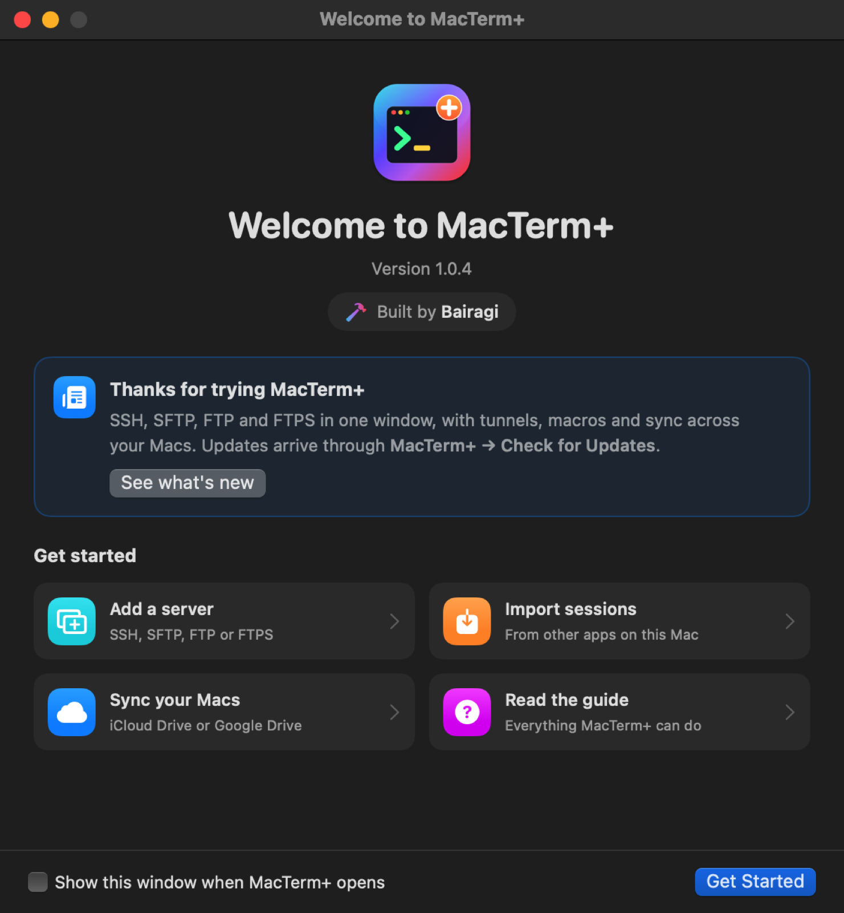
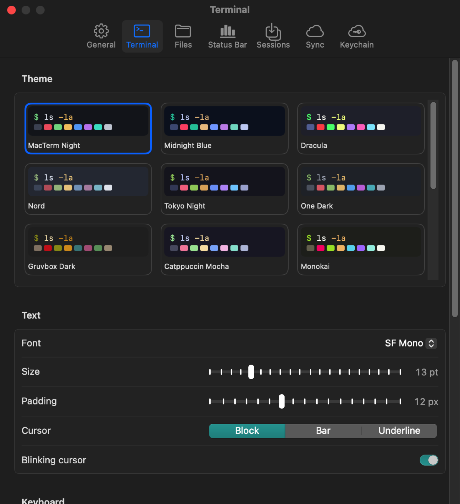

# MacTerm+

**SSH terminal, SFTP & FTP file manager, tunnels and tools — in one window.** 
A native app for Macs with Apple Silicon. Built by Bairagi.

### [⬇︎ Download MacTerm+](https://github.com/engsawankumar/MacTermPlus/releases/latest) · [📖 Wiki & user guide](https://github.com/engsawankumar/MacTermPlus/wiki)

> [!CAUTION]
> **Free for personal and non-commercial use only.** Commercial use is not allowed without written permission.
> MacTerm+ is provided as is, without warranty. **By downloading or using it you accept the [license](LICENSE)
> and agree that you, the user, are solely responsible for how you use it.** Read the
> [terms of use](#license-terms-of-use-and-disclaimer) before you start; the app asks you to accept them on first launch.

---

## Why MacTerm+

- **One window for your servers.** Open a server and you get a terminal, its files next to it,
  and live health stats underneath, all over a single secure connection.
- **Every common protocol:** SSH, SFTP, FTP and FTPS.
- **Feels at home on the Mac.** Native, fast on Apple Silicon, light and dark mode, Keychain for passwords.
- **Brings your sessions along.** It finds the sessions you already saved in other SSH/FTP apps and imports them in a few clicks.
- **Keeps itself up to date.** New versions install from inside the app.

## Features

| Feature | What you get |
|---|---|
| 🖥 **Terminal** | Tabs, split view (2 or 4 terminals), 17 color themes, per-server themes, copy & paste with preview, macros, **Quick Commands** (50+ ready-made server commands in folders, starred favorites, search) |
| 📁 **Files** | File browser beside the terminal, two-pane Mac ↔ server view, drag & drop, upload and download whole folders, edit any file in your favorite Mac app |
| 🔐 **Permissions** | Change file permissions with checkboxes, presets or octal values, for one file or a whole folder |
| 📊 **Server info** | CPU graph, memory, network speed, disk space, uptime and the server's OS at a glance |
| 🔑 **Keychain** | SSH keys (create, add, fingerprints, permission check), reusable **identities** shared by many servers, known hosts, and saved passwords you can view with Touch ID |
| 🔀 **Tunnels** | Reach databases and admin pages behind a server through a port on your Mac |
| ⌨️ **MultiExec** | Type once, run in every open terminal |
| ⬇️ **Import** | Finds sessions saved by other apps on this Mac (including Windows apps in compatibility layers), plus `~/.ssh/config`, CSV and the Passwords app |
| ☁️ **Sync** | Keep sessions, settings, macros, quick commands and tunnels the same on all your Macs with iCloud Drive or Google Drive, set up in three steps; passwords optional and end-to-end encrypted |
| 🎨 **Make it yours** | Colors and OS icons for servers, fonts, padding, icon styles, accent colors |

## Screenshots

<table>
<tr>
<td width="50%"> <b>Two-pane files:</b> your Mac on the left, the server on the right.</td>
<td width="50%"> <b>Sessions:</b> folders, colors and the server's OS at a glance.</td>
</tr>
<tr>
<td width="50%"> <b>Welcome:</b> get started in one click.</td>
<td width="50%"> <b>Themes:</b> 17 terminal color themes, fonts and more.</td>
</tr>
</table>

## Install

1. **Download** `MacTerm+-x.y.z.dmg` from the [latest release](https://github.com/engsawankumar/MacTermPlus/releases/latest).
2. **Open** the DMG and **drag MacTerm+ to Applications**.
3. **Open MacTerm+** from Applications or Launchpad.

**The first time you open it**, macOS may say it can't check MacTerm+ for malicious software, because the
app isn't distributed through the App Store. To open it anyway:

1. Click **Done** in that message.
2. Open **System Settings → Privacy & Security**.
3. Scroll down to the message about MacTerm+ and click **Open Anyway**, then confirm.

You only do this once; updates from inside the app open normally.

**Requirements:** a Mac with Apple Silicon (M1 or newer) and macOS 15 Sequoia or later.

## Getting started

- **Add a server:** click **Session** (or press ⌘N), enter the host, user name and password or key, then **Save & Connect**.
- **Import what you have:** press ⇧⌘I. MacTerm+ lists the sessions it found on your Mac; tick the ones you want.
- **Quick connect:** type `user@host` (or `sftp://…`, `ftp://…`) into the field at the top of the sidebar and press Return.
- **Learn more:** press ⌘? for the built-in guide, or read the [User guide](docs/USER_GUIDE.md).

| Shortcut | Action |
|---|---|
| ⌘N | New session |
| ⌘T | New local shell |
| ⇧⌘I | Import sessions |
| ⇧⌘W | Close tab |
| ⇧⌘] / ⇧⌘[ | Next / previous tab |
| ⌘, | Settings |
| ⌘? | Help |

## Updates

MacTerm+ checks for new versions once a day. You can also choose **MacTerm+ → Check for Updates…** at any time.
Updates are downloaded from this page, checked against a published checksum and the developer's signature,
and installed with one click. Your sessions and settings stay as they are.

## Privacy & security

- Passwords stay on your Mac: in the **macOS Keychain**, or in an optional **MacTerm+ encrypted vault** unlocked with one master password (Settings → Passwords).
- Updates and Welcome news are **download-only**: MacTerm+ never sends your sessions, server names or passwords anywhere.
- Server identities are remembered on first connect; if a server's key ever changes, MacTerm+ warns you and doesn't connect.
- Sync only writes to **your own** iCloud Drive or Google Drive folder. Passwords sync only if you turn it on, encrypted with a passphrase that never leaves your Macs.
- No accounts, no tracking. The app contacts GitHub only to check for updates and, if you leave it on, Welcome window news.

## FAQ

<b>macOS asks for my Keychain password after an update</b>

Choose **Always Allow**. Since 1.0.6 all passwords live in **one** Keychain item, so you're asked **once per
update** (not once per password), and not at all between updates. macOS re-confirms after each update because
MacTerm+ isn't signed with a paid Apple developer ID. For no macOS prompts at all, switch to the
**MacTerm+ encrypted vault** in Settings → Passwords (you type one master password when MacTerm+ opens).

<b>“keyExchangeNegotiationFailure” or “no encryption method in common”</b>

Some older routers and devices only offer older SSH algorithms. Make sure
**Settings → Terminal → Connections → Allow older SSH algorithms** is on (it is by default) and update
to the latest MacTerm+.

<b>Can I use an SSH key instead of a password?</b>

Yes. In the session, choose **Private key** and pick your key (Ed25519 or RSA, OpenSSH format).
**Tools → Generate Key** creates one, and **Install my public key** adds it to a server.

<b>Does it work on Intel Macs?</b>

Not at the moment. MacTerm+ is built for Apple Silicon.

## Feedback

Found a bug or have an idea? [Open an issue](https://github.com/engsawankumar/MacTermPlus/issues). It helps a lot.

## License, terms of use and disclaimer

MacTerm+ is **source-available**: you can read, learn from and improve the code, but it is licensed for
**non-commercial use only**. The full terms are in [LICENSE](LICENSE).

**✅ You may** use, copy and modify MacTerm+ for personal use, learning, research, teaching and non-profit work,
and share it with the license and the "Built by Bairagi" credit kept intact.

**❌ You may not**, without written permission, sell it, include it or its code in paid products, services or
client projects, offer it under a paid or ad-supported plan, or remove the credit or license.

**⚠️ Use responsibly.** Use MacTerm+ only on servers, networks and accounts that you own or are authorized to
access, and follow the laws that apply to you.

**🛡️ No warranty and no liability.** MacTerm+ is provided **"as is"**, without any warranty. The developer is
**not liable** for any unethical, unauthorized or illegal use of this software by anyone, or for any data loss,
downtime, security incident or other damage that results from using it.

**🤝 Your consent.** By downloading, installing or using MacTerm+, you confirm that you have read and accept
the [license](LICENSE), and you agree that **all responsibility and liability for its use lies with you, the
user, and not with the developer**. If you do not agree, do not download or use MacTerm+.

**📩 Copyright, complaints and commercial use.** If you believe something in MacTerm+ infringes your copyright
or other rights, have any complaint, or want to use it commercially, please
[open an issue](https://github.com/engsawankumar/MacTermPlus/issues/new/choose). Reports are reviewed
promptly, and anything found to infringe will be removed or changed.

Third-party components keep their own open-source licenses (MIT and Apache-2.0); see
[Third-party notices](THIRD_PARTY_NOTICES.md).

## Credits

**MacTerm+ is built by Bairagi.** It uses a few open-source components; see [Third-party notices](THIRD_PARTY_NOTICES.md).

Developers: build, signing and release instructions are in [docs/DEVELOPMENT.md](docs/DEVELOPMENT.md).
